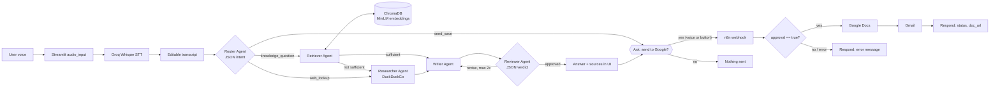

# 🎙️ VoiceFlow Agent
A voice-controlled multi-agent assistant with RAG and n8n automation.
Speak a request → Whisper transcript (editable) → Router / Retriever / Researcher / Writer / Reviewer agents → cited answer → *"Send this to your Google account?"* → yes → n8n creates a Google Doc and emails you.

It is a **web app** (Streamlit). Locally it opens in your browser; deployed on Streamlit Community Cloud it has a public URL you can open on any device (see "Use it as a website").

## Folder structure
```
voiceflow/
├── app.py                 # Streamlit UI (voice, transcript, answer, approval)
├── agents.py              # CrewAI agents + pipeline (Router → Retriever → Researcher → Writer ⇄ Reviewer)
├── rag.py                 # chunking, HF embeddings, ChromaDB
├── voice.py               # Groq Whisper + yes/no understanding
├── n8n_client.py          # webhook client (refuses to run without approved=True)
├── config.py              # settings; secrets from .env or Streamlit secrets
├── eval_prompts.py        # runs v1 vs v2 on tests/test_queries.json
├── prompts/v1, prompts/v2 # one .md per agent (role, goal, constraints, output format, fallback)
├── n8n/voiceflow_workflow.json
├── samples/northwind_handbook.txt   # demo knowledge base
├── tests/test_queries.json
├── docs/TEST_PLAN.md, docs/REPORT_OUTLINE.md
├── requirements.txt, .env.example, .streamlit/secrets.toml.example, .gitignore
```

## Architecture


## Setup (local)
1. Python 3.10–3.13. `python -m venv .venv`, activate it, then `pip install -r requirements.txt`.
2. Free keys: **Groq** (console.groq.com → API Keys) and **Hugging Face** (huggingface.co/settings/tokens, a *read* token).
3. `cp .env.example .env` and fill `GROQ_API_KEY`, `HF_TOKEN`. Add `N8N_WEBHOOK_URL` after step "n8n" below.
4. `streamlit run app.py`. Upload `samples/northwind_handbook.txt` in the sidebar.

Tuning: MiniLM reads about 256 tokens, so `CHUNK_TOKENS=200` often retrieves better than the 800 default. Keep 800 for the course spec, then compare.

## n8n workflow: import and credentials
Free options: **n8n Cloud free trial**, or self-host (`npx n8n` / Docker), which is free.

1. In n8n: **Workflows → Import from file** → `n8n/voiceflow_workflow.json`.
2. **Google Cloud Console** (console.cloud.google.com):
   1. Create a project. **APIs & Services → Library**: enable *Google Docs API*, *Google Drive API*, *Gmail API*.
   2. **OAuth consent screen**: User type *External*, fill app name/email, add your Gmail under **Test users**.
   3. **Credentials → Create credentials → OAuth client ID → Web application**. In n8n, open a Google credential and copy its **OAuth Redirect URL**; paste it into *Authorized redirect URIs*. Save and copy the **Client ID** and **Client secret**.
3. In n8n create credentials **Google Docs OAuth2 API** and **Gmail OAuth2 API**: paste Client ID/secret → **Sign in with Google** → allow access.
4. Open the nodes *Create Google Doc*, *Write Content*, *Send Gmail* and select your credentials (replaces `REPLACE_ME`).
5. Click **Test workflow**, copy the **Test URL**, and try it (see below). When it works, toggle the workflow **Active** and copy the **Production URL** (`…/webhook/voiceflow`) into `N8N_WEBHOOK_URL`.

Quick test (replace URL and email):
```bash
curl -X POST "https://YOUR-N8N/webhook-test/voiceflow" -H "Content-Type: application/json" \
 -d '{"title":"Test","content":"Hello from curl","recipient_email":"you@gmail.com","format":"doc","approval":true}'
```
Expected: `{"status":"success","doc_url":"https://docs.google.com/document/d/.../edit"}`. With `"approval":false` you get a 403 and `status: error`.

Workflow nodes: Webhook (POST) → *Approved?* (approval is true, email and content not empty) → Create Google Doc → Write Content → Send Gmail → Respond Success. The false branch goes to *Respond Not Approved*; every Google node has an error output that goes to *Respond Error*. Approval is enforced twice: in `n8n_client.py` and again in the IF node.

## Demo script (about 4 minutes)
1. Upload `northwind_handbook.txt`. Say: *"How many days per week can employees work remotely?"* Edit the transcript if needed → **Ask the agents**.
2. Show the cited answer, then **Evidence used** and **Agent trace**.
3. Say: *"What is the company's policy on pets in the office?"* → shows "I don't know" (guardrail).
4. Say: *"Search the web for the latest news about the Artemis moon program."* → Researcher agent runs.
5. When asked *"Would you like me to send this to your Google account?"*, say **"yes, send it"** → open the Google Doc link and show the Gmail.
6. Show the sidebar prompt version switch (v1 vs v2) and `eval_results.md`.

Screenshots (add yours to `docs/img/`):
`` · `` · `` · `` · ``

## Prompt engineering
| Technique | Where |
|---|---|
| Versioned prompts (role, goal, constraints, output format, fallback) | `prompts/v1`, `prompts/v2` |
| Few-shot intent classification (8 examples, incl. an injection and a "nothing to send" case) | `prompts/v2/router.md` |
| JSON outputs with safe parsing and fallbacks | Router, Retriever, Researcher, Reviewer + `agents.extract_json` |
| Grounding: evidence only, mandatory `[S#]` citations, "I don't know" | Writer + Reviewer v2, and a code guardrail when no evidence exists |
| Prompt-injection resistance (text in transcript, passages, web results is *data*) | all v2 prompts |
| No send without approval | `n8n_client.py`, `app.py`, n8n IF node |

### Prompt evaluation (v1 vs v2)
Run `python eval_prompts.py`. It runs the 12 queries in `tests/test_queries.json` against both versions and writes `eval_results.md` with per-query **accuracy / groundedness / format compliance**. Paste the generated table here. I have not filled in numbers myself because they depend on your model run and knowledge base; do not report results you did not measure.

| Metric | v1 | v2 |
|---|---|---|
| Accuracy | _/12 | _/12 |
| Groundedness | _/12 | _/12 |
| Format compliance | _/12 | _/12 |

## Use it as a website
Yes. Streamlit serves a normal web page.
- **Local:** `streamlit run app.py` → `http://localhost:8501`.
- **Public:** deploy to Streamlit Community Cloud (below) and share the `*.streamlit.app` URL. The microphone works because it is served over HTTPS.
- **Important:** Streamlit Cloud cannot reach an n8n running on your laptop. Use **n8n Cloud** or a tunnel (ngrok / Cloudflare Tunnel) so `N8N_WEBHOOK_URL` is publicly reachable.
- **Important:** Streamlit Cloud's disk is temporary. The ChromaDB folder resets when the app restarts, so re-upload documents (or use a hosted vector DB later).
- The app has no login. Anyone with the URL can use your API keys' quota and send email to the address typed in the sidebar. Keep the app private (Streamlit → Share → restrict viewers) or add authentication before sharing widely.

## Deploy: GitHub + Streamlit Community Cloud
1. `git init && git add . && git commit -m "VoiceFlow Agent"`. Check `git status` shows no `.env`.
2. Create an empty GitHub repo, then `git remote add origin <url> && git branch -M main && git push -u origin main`.
3. Go to share.streamlit.io → **New app** → pick the repo, branch `main`, main file `app.py`. In **Advanced settings** choose Python 3.12 and paste your secrets (format in `.streamlit/secrets.toml.example`).
4. **Deploy.** First build takes a few minutes. If you see a SQLite error, confirm `pysqlite3-binary` is in `requirements.txt`.
5. Test with the 10 queries in `docs/TEST_PLAN.md`.

## Limitations
Free-tier rate limits (Groq, Hugging Face) can slow or fail requests; retries are built in. Scanned PDFs need OCR. DuckDuckGo results vary. Whisper can mishear names, which is why the transcript is editable. A single shared knowledge base, no user accounts.
